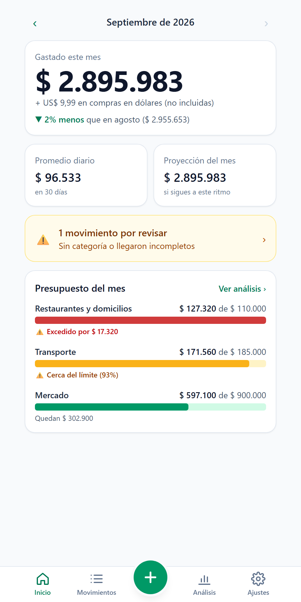
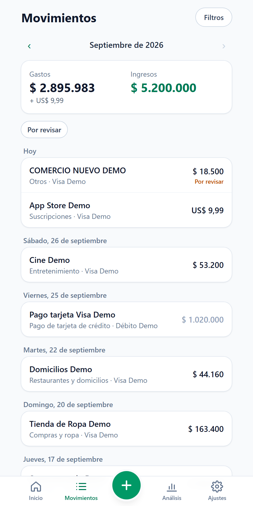
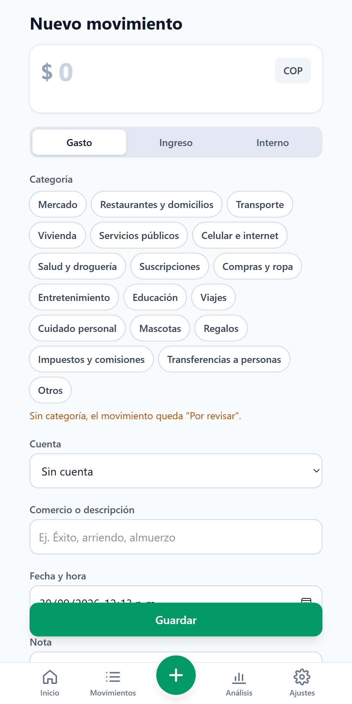
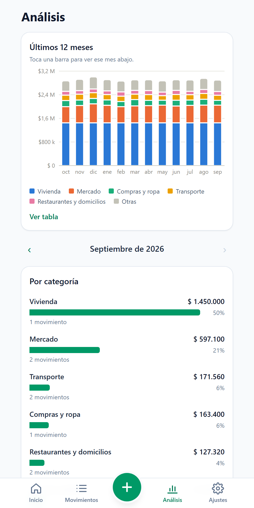

# Personal Finance — automatic expense tracking on Cloudflare's free tier

A private, single-user personal finance app. Every **Apple Pay** payment is recorded **automatically** through an iOS Shortcut, and a mobile-first dashboard (installable as a PWA) shows where the money goes. It runs as **one Cloudflare Worker** with a **D1** (SQLite) database, protected by **Cloudflare Access**, and costs **$0/month**.

> The UI is in Spanish (built for use in Colombia); code, API and this README are in English.

| Home | Transactions | New transaction | Analysis |
|---|---|---|---|
|  |  |  |  |

*Screenshots use made-up demo data (`scripts/demo-seed.sql`).*

---

## What it does

- **Automatic capture:** an iOS "Wallet" automation fires on every Apple Pay tap and POSTs merchant, amount and card to the API. The phone shows a notification such as `$ 25.000 · Rappi · Restaurantes y domicilios`.
- **Rules-based categorization:** "if the merchant contains X → clean name, category, type". Matching ignores case and accents, and the lowest priority wins. When you fix a category in the UI, the app offers to create the rule for you.
- **"Por revisar" (to-review) inbox:** anything incomplete or unrecognized is stored anyway and flagged for review, never dropped.
- **Dashboards:**
  - month total with a like-for-like comparison against the previous month;
  - daily average and end-of-month projection;
  - budget vs. actual;
  - 12-month stacked bars;
  - top merchants, and spending by category and by card.
- **Manual entry and management:** CRUD for transactions, categories, accounts and rules; filters and search; CSV export ready for Spanish-locale Excel.

## Architecture

```
iPhone Shortcut (Apple Pay) ──► /api/ingest/*  ┐
                                               ├─► Cloudflare Worker (Hono + Zod) ──► D1 (SQLite)
React PWA (phone & desktop) ──► /api/*         ┘         │
                                                         └─ serves the React build as static assets

Everything sits behind Cloudflare Access (Zero Trust).
```

| Layer | Tech |
|---|---|
| Runtime & hosting | Cloudflare Workers + static assets (one deployment for API and frontend) |
| API | TypeScript, [Hono](https://hono.dev), [Zod](https://zod.dev) validation |
| Database | Cloudflare D1 (SQLite) with Wrangler migrations |
| Frontend | React 19, Vite, Tailwind CSS 4, React Router, Recharts (lazy-loaded) |
| Auth | Cloudflare Access + in-Worker JWT verification ([jose](https://github.com/panva/jose)) |
| Tests | Vitest running **inside the Workers runtime** (`@cloudflare/vitest-plugin`) with a real local D1 |

```
src/
├─ shared/     # used by both API and UI: money parsing, Bogotá dates, API types, labels
├─ worker/     # Hono API: auth, routes (transactions, stats, ingest, export…), lib (categorize, dedupe)
└─ react-app/  # PWA: pages, components, data hooks
migrations/    # D1 schema + seed of default categories
test/          # 159 tests, all with fictitious data
docs/          # step-by-step setup guides (Spanish)
```

## Data integrity decisions

- **Money is integers, never floats.** Amounts are stored as `amount_minor` (cents) plus a `currency`, and formatting happens only at the edge with `Intl.NumberFormat`.
- **Amounts in both COP and US formats.** iOS may send `$25.000,00` or `$25,000.00` depending on the locale. `parseAmount` decides by the *last* separator: if 1–2 digits follow it, it's the decimal separator; exactly 3 digits means thousands. `US$`/`USD` switch the currency. Empty, zero or garbage amounts don't fail: they go to review.
- **Dates in America/Bogotá.** The Worker runs in UTC, so a purchase at 9 p.m. in Bogotá would otherwise land on the next day. Every row keeps `occurred_at`, an ISO timestamp with offset, and `local_date` in Bogotá time for grouping. Impossible dates such as Feb 31 are rejected.
- **De-duplication.** `dedupe_key` is a SHA-256 of source, account, amount, normalized merchant and the timestamp rounded to the minute, stored in a `UNIQUE` column. A repeated Shortcut call hits `ON CONFLICT DO NOTHING` and returns the original row (`duplicate: true`).
- **No double counting.** Paying a credit card, or moving money between your own accounts, is typed `internal` and **never** counts as spending. Otherwise a $100 card purchase plus the $100 card payment would show $200 spent. All stats filter on `type = 'expense'` in SQL.
- **Nothing is lost.** The ingest endpoint stores whatever arrives, even non-JSON. The raw payload is kept for debugging, and the row is flagged `status = 'review'` if the amount, merchant, card or a categorizing rule is missing.
- **Referential sanity.** A transaction's category must match its type, for example no "Salary" on an expense. Categories and accounts in use can't be deleted (409); accounts are deactivated instead.
- **Aggregations in SQL, indexed by date**, to stay well within the D1 free-tier read limits.

## Security

- **Cloudflare Access protects the whole Worker**: UI, API and static assets. Only the owner's identity can log in.
- **Defense in depth:** the Worker verifies the Access JWT itself (signature via JWKS, `iss`, `aud`) and checks the email against an allow-list. If Access were ever misconfigured, the API would still reject every request.
- **Machine access is scoped.** The iPhone Shortcut authenticates with an Access **Service Token**. Its JWT carries no email, only the token's client ID, and the Worker accepts it **only** for `/api/ingest/*`: it cannot read, export or delete anything.
- **Second factor for ingest:** `/api/ingest/*` also requires an `X-Ingest-Key` secret, compared in **constant time** (`crypto.subtle.timingSafeEqual` over SHA-256 digests).
- **SQL is always parameterized** (`prepare().bind()`). The only dynamic SQL fragments are fixed column names from code.
- **CSV export guards against formula injection**: cells starting with `= + - @` are prefixed.
- **Secrets never live in the repo.** `INGEST_KEY` is a Wrangler secret, and the local-dev auth bypass requires both a `.dev.vars` flag **and** a `localhost` host.

## Running it locally

Requirements: Node.js 20+ (developed on Node 24).

```bash
npm install
cp .dev.vars.example .dev.vars   # enables the localhost-only auth bypass
npm run db:migrate:local         # create tables + default categories
npm run db:seed:demo             # optional: made-up accounts, rules, budgets and 12 months of data
npm run dev                      # http://localhost:5173
```

## Tests

```bash
npm test          # 159 tests in the Workers runtime (each test file gets an isolated D1)
npm run lint
npm run build     # type-check + production build
```

Coverage highlights:
- money parsing in both COP and US formats, and Bogotá date edge cases (9 p.m. purchases, year boundary, leap day);
- Access JWT validation, including wrong audience or issuer, expired tokens, tokens signed with another key and service-token scoping;
- ingest (rules, card matching, garbage input, duplicates);
- stats with a frozen clock;
- CSV output byte-for-byte, including the UTF-8 BOM.

## Deploying your own copy

The guides in [`docs/`](docs) (in Spanish) walk through every step. In short:

1. Create a D1 database, then put its id and your Access values in `wrangler.jsonc`. It ships with placeholders only.
2. Run `npm run db:migrate:remote`, then `npm run deploy`.
3. Enable Cloudflare Access on the Worker (Zero Trust free plan), then fill in `ACCESS_TEAM_DOMAIN`, `ACCESS_AUD` and `ALLOWED_EMAILS`.
4. For automatic Apple Pay capture:
   - create an Access Service Token with a *Service Auth* policy;
   - run `wrangler secret put INGEST_KEY`;
   - build the Shortcut following [`docs/atajo-apple-pay.md`](docs/atajo-apple-pay.md).

## How it was built

The project was built phase by phase with an AI pair programmer (Claude Code), driven by the spec in [`CLAUDE.md`](CLAUDE.md), which is in Spanish. That spec covers constraints ($0, no server, private data), the data model, business rules and a phased plan. Each phase was planned first, tested, deployed and verified on a real iPhone before moving on.

## License

[MIT](LICENSE)
